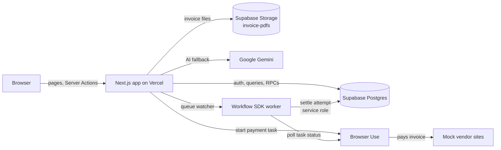
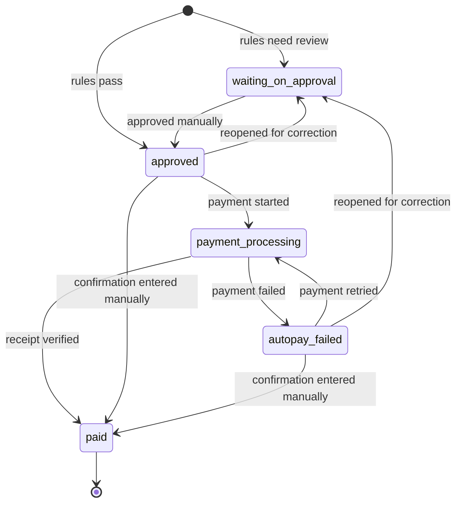
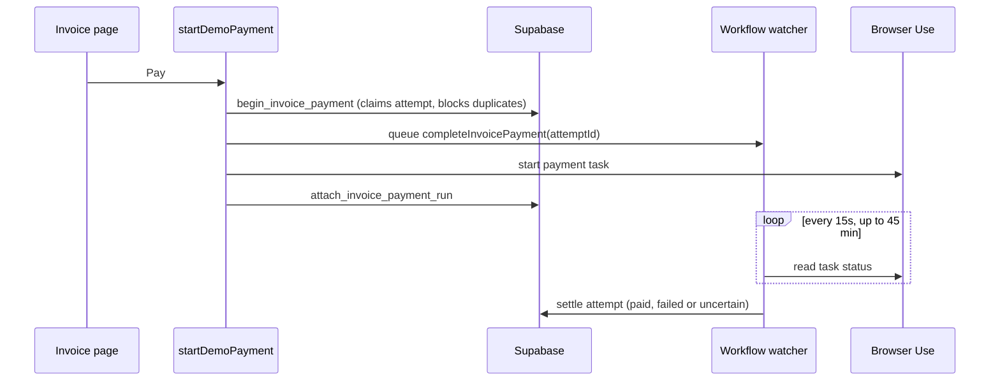

# Architecture

How the invoice app is put together: the main parts, how a request moves through them, and where each responsibility lives. For the list of technologies, see [tech-stack.md](./tech-stack.md). For coding conventions, see [code-patterns/](./code-patterns/index.md).

## System overview

The app is a single Next.js application deployed on Vercel. It has no separate backend service. Server Components, Server Actions and Route Handlers do the server work. Supabase provides auth, Postgres and file storage, and the database enforces the business rules.

## Layers

| Layer | Location | Responsibility |
|---|---|---|
| Auth gate | `frontend/proxy.ts`, `frontend/utils/supabase/middleware.ts` | Refreshes the Supabase session on every request and redirects anonymous users to `/login` |
| Pages | `frontend/app/**/page.tsx` | Server Components that fetch data and render it |
| Interactivity | `frontend/app/**/*.client.tsx`, `frontend/components/` | Client components for forms, dialogs and the CoreUI shell |
| Mutations | `frontend/app/**/actions.ts` | Server Actions that check auth, call Supabase or RPCs, then refresh |
| Route Handlers | `frontend/app/api/` | File upload, invoice extraction and event search |
| Domain logic | `frontend/lib/` | Pure helpers for parsing, extraction, payment checks, statuses and roles |
| Background jobs | `frontend/workflows/` | A durable payment watcher built on the Workflow SDK |
| Database | `frontend/supabase/migrations/` | Tables, RLS policies, triggers and RPC functions |

## Data model

The core tables are `invoices`, `vendors`, `properties` and `profiles`. `profiles` is linked to Supabase auth users and stores each user's role: `clerk`, `approver` or `admin`. Supporting tables:

- `approval_rule_settings`: the configurable auto-approval rules
- `invoice_rule_evaluations`: why each new invoice was or wasn't auto-approved
- `invoice_payment_attempts`: one row per payment attempt, with its Browser Use run ID and result
- `audit_events`: the change history, written by triggers and shown on the Activity page

See [`frontend/supabase/erd.jpg`](../frontend/supabase/erd.jpg) for the diagram.

**The database is the source of truth for the rules.** Clients cannot write invoice status directly. Status changes go through RPC functions such as `create_invoice_with_rules`, `approve_invoice_manually`, `begin_invoice_payment` and `reopen_invoice_for_correction`. Triggers block hard deletes, lock the fields of approved and paid invoices, and keep the last admin from being demoted.

### Invoice lifecycle

The status list lives in `frontend/lib/invoices/status.ts`. The intake RPC returns only `approved` or `waiting on approval`, so `created` is a legacy value. Approved, processing, failed and paid invoices are locked for editing; reopening is the only way to change them.

## Key flows

### 1. Upload and extract

1. The user picks a PDF or image on `/invoices/new`.
2. `POST /api/invoices/document` stores the file in the `invoice-pdfs` bucket, in a folder owned by the user.
3. `POST /api/invoices/extract` first reads the PDF text with `pdf-parse`. If any of the four required fields are missing, it calls Gemini to fill **only the gaps**. Parsed values are never overwritten.
4. If fields are still missing, the form flags them for the user to complete. Values are never invented.

Code: `frontend/lib/invoices/extraction.ts`, `extract-invoice.ts`, `ai-extraction.ts`.

### 2. Save and approve

`createInvoice` calls the `create_invoice_with_rules` RPC. The RPC evaluates the approval rules once, at intake, and sets the status to `approved` or `waiting on approval`. It also records the reasons. A signed-in user can then approve a waiting invoice with `approve_invoice_manually`. That RPC currently checks sign-in only, not role. When an invoice becomes approved and its vendor has `autopay` on, the server starts payment automatically (`startAutopay` in `frontend/app/invoices/actions.ts`).

### 3. Pay through the mock vendor site

Design choices that keep payments safe:

- **One attempt at a time.** `begin_invoice_payment` reserves the attempt in the database, so a double click cannot pay twice.
- **Watcher before side effect.** The watcher is queued before the external task starts. If scheduling fails, nothing has been paid.
- **No external calls in the workflow.** Workflow retries only read status and settle the attempt. They never start a new payment.
- **The server checks the result.** The browser sends only an invoice ID. The server compares the receipt with the expected amount, vendor and reference.
- **Uncertain means locked.** If the outcome is unclear, the invoice stays locked for a person to resolve.

Code: `frontend/app/invoices/payment-actions.ts`, `frontend/lib/invoices/browser-use.ts`, `payment.ts`, and `frontend/workflows/`. See also [PLANS/browser-use-payments.md](./PLANS/browser-use-payments.md).

## Security model

- **Authentication:** Supabase Auth with cookie sessions, refreshed by `proxy.ts`. The Workflow SDK's `/.well-known/workflow/` routes skip the proxy because the SDK requires it.
- **Authorization:** Row Level Security is enabled on the app tables, and status changes go only through `security definer` RPCs. `getAccess` and `requireAdmin` in `frontend/lib/users/access.ts` load the user's role. The Rules and Users pages and the Activity viewer are admin-only.
- **Secrets:** Only `NEXT_PUBLIC_SUPABASE_URL` and the publishable key reach the browser. `SUPABASE_SECRET_KEY`, `BROWSER_USE_API_KEY` and `GEMINI_API_KEY` stay on the server. The service-role client is used only in `frontend/lib/invoices/payment-worker-client.ts`, by the background worker.

## Deployment and CI

- **Hosting:** Vercel runs the Next.js app and the workflow worker. The extraction route sets `maxDuration = 180` so AI calls have time to finish.
- **Database:** Supabase applies the migrations in `frontend/supabase/migrations/`.
- **CI:** `.github/workflows/pr-validation.yml` runs lint, type checks, tests and a build on every PR to `main`.
